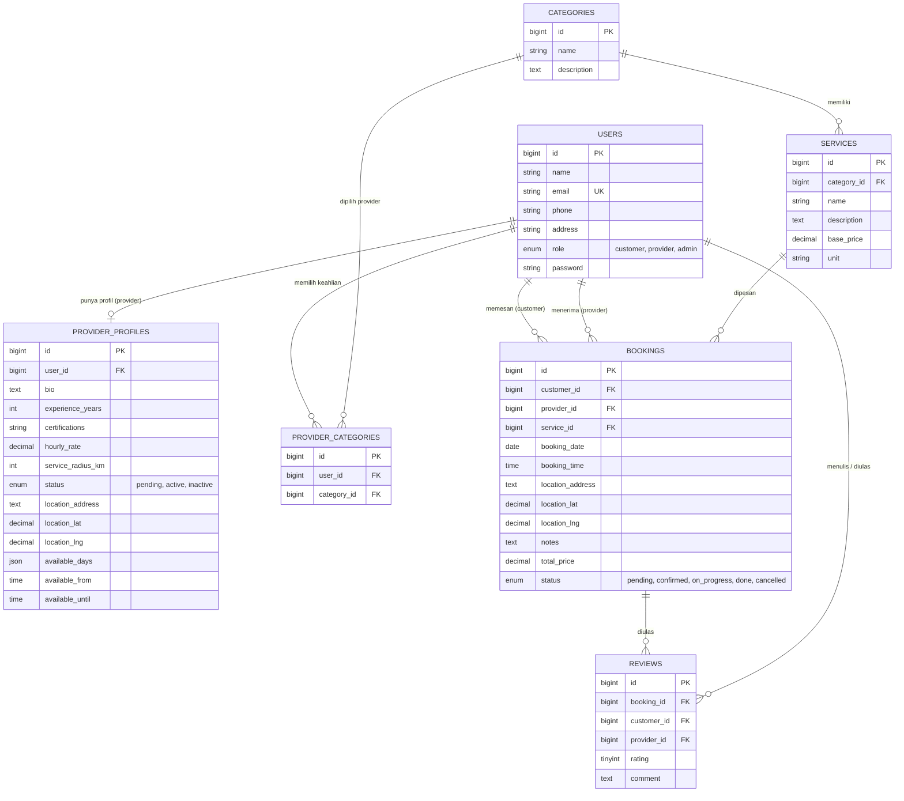

# Service Booking

Aplikasi web untuk mempermudah pengusaha mikro dan pekerja jasa, seperti tukang AC, tukang kebun, atau teknisi, dalam mendapatkan pelanggan. Selama ini pekerjaan seperti ini banyak tersebar dari mulut ke mulut. Service Booking mempertemukan pelanggan dengan penyedia jasa terdekat dalam satu platform, lengkap dengan peta lokasi dan sistem pemesanan.

## Daftar Isi

- [Fitur](#fitur)
- [Peran Pengguna](#peran-pengguna)
- [Tech Stack](#tech-stack)
- [Screenshot](#screenshot)
- [Instalasi](#instalasi)
- [Skema Database](#skema-database)
- [Struktur Folder](#struktur-folder)
- [Lisensi](#lisensi)
- [Kontributor](#kontributor)

## Fitur

- Autentikasi: registrasi dan login, dengan pilihan mendaftar sebagai Customer atau Provider.
- Tiga peran pengguna (Admin, Customer, Provider) dengan dashboard masing-masing.
- Kategori layanan, misalnya Kebersihan Rumah atau Gedung, Perbaikan & Renovasi, Perawatan Taman, dan Perawatan Alat Elektronik.
- Pemilihan provider berdasarkan keahlian dan lokasi terdekat, ditampilkan di peta interaktif.
- Deteksi lokasi otomatis atau pilih lokasi langsung dengan klik pada peta (Leaflet + OpenStreetMap).
- Radius layanan provider yang divisualisasikan di peta.
- Jadwal ketersediaan provider (hari dan jam kerja).
- Pemesanan dengan tanggal, waktu, lokasi, dan catatan tambahan.
- Status booking: `pending`, `confirmed`, `on_progress`, `done`, dan `cancelled`.
- Panel admin untuk mengelola seluruh alur bisnis.

## Peran Pengguna

### Customer
- Melihat kategori layanan dan memilih provider yang tersedia.
- Melihat peta sebaran provider beserta radius layanannya.
- Membuat booking: memilih tanggal, waktu, titik lokasi, dan catatan.
- Memantau booking terbaru dari dashboard.
- Mengelola profil.

### Provider
- Mengisi profil penyedia jasa: bio, pengalaman (tahun), sertifikasi atau keahlian khusus.
- Menentukan lokasi, radius layanan, hari tersedia, dan jam kerja.
- Memilih satu atau lebih kategori keahlian.
- Melihat ringkasan booking (menunggu, dikonfirmasi, selesai) di dashboard.

### Admin
- Dashboard ringkasan: jumlah customer, provider, total booking, dan status booking.
- Peta sebaran provider.
- Kelola booking (dengan filter status dan tanggal).
- Kelola user (lihat detail, kelola akun dan status provider).
- Kelola kategori layanan.
- Kelola service (nama, kategori, harga, satuan).
- Kelola profil sendiri dan ganti password.

## Tech Stack

| Bagian | Teknologi |
| --- | --- |
| Bahasa | PHP |
| Framework | Laravel |
| Frontend | Bootstrap, Blade Templates |
| Peta | Leaflet (tile OpenStreetMap) |
| Database | MySQL |
| Package manager | Composer, npm |

## Screenshot

> Simpan gambar di folder `docs/screenshots/` lalu sesuaikan nama file di bawah.

### Halaman Publik


### Customer


### Provider


### Admin


## Instalasi

### Prasyarat

Pastikan sudah terpasang:

- PHP (sesuai versi yang dibutuhkan Laravel pada proyek ini, lihat `composer.json`)
- [Composer](https://getcomposer.org/)
- [Node.js](https://nodejs.org/) dan npm
- MySQL (bisa lewat XAMPP, Laragon, atau instalasi MySQL biasa)

### Langkah

1. **Clone repository**

   ```bash
   git clone <url-repository-kamu>
   cd service-booking
   ```

2. **Install dependency PHP**

   ```bash
   composer install
   ```

3. **Siapkan file environment**

   ```bash
   cp .env.example .env
   php artisan key:generate
   ```

4. **Atur database di `.env`**

   Buat database kosong bernama `service_booking` di MySQL, lalu isi konfigurasinya:

   ```env
   DB_CONNECTION=mysql
   DB_HOST=127.0.0.1
   DB_PORT=3306
   DB_DATABASE=service_booking
   DB_USERNAME=root
   DB_PASSWORD=
   ```

5. **Jalankan migrasi dan seeder**

   ```bash
   php artisan migrate --seed
   ```

6. **Install dependency frontend dan build aset**

   ```bash
   npm install
   npm run dev
   ```

   Untuk produksi gunakan `npm run build`.

7. **Jalankan aplikasi**

   ```bash
   php artisan serve
   ```

   Buka `http://127.0.0.1:8000` di browser.

### Akun Awal

Seeder membuat akun contoh untuk tiap peran. Cek file di `database/seeders/` untuk email dan password default, lalu **ganti sebelum dipakai di produksi**.

### Catatan

- Peta memerlukan koneksi internet karena memuat tile dari OpenStreetMap.
- Fitur "Deteksi Lokasi Otomatis" memakai Geolocation API browser, jadi perlu izin lokasi dan sebaiknya diakses lewat `localhost` atau HTTPS.

## Skema Database

Database menggunakan MySQL dengan nama `service_booking`. Selain tabel bawaan Laravel (`cache`, `cache_locks`, `jobs`, `job_batches`, `failed_jobs`, `migrations`), aplikasi ini memiliki tabel berikut.

### Diagram Relasi



### Ringkasan Tabel

| Tabel | Fungsi |
| --- | --- |
| `users` | Semua akun. Kolom `role` menentukan peran: `customer`, `provider`, atau `admin`. |
| `provider_profiles` | Profil provider: bio, pengalaman, sertifikasi, lokasi, radius layanan, jadwal ketersediaan, dan status akun (`pending`, `active`, `inactive`). |
| `categories` | Kategori layanan, misalnya Perawatan Taman atau Perbaikan & Renovasi. |
| `provider_categories` | Tabel pivot antara provider (`users`) dan kategori keahliannya. |
| `services` | Layanan di dalam kategori, lengkap dengan harga dasar (`base_price`) dan satuan (`unit`, misalnya jam, unit, atau visit). |
| `bookings` | Pesanan customer ke provider untuk satu layanan, termasuk jadwal, titik lokasi (alamat, latitude, longitude), catatan, total harga, dan status. |
| `reviews` | Ulasan dan rating (`rating`) customer untuk booking yang sudah selesai. |

### Catatan

- `bookings.customer_id` dan `bookings.provider_id` sama-sama mengarah ke tabel `users`.
- Semua foreign key memakai `ON DELETE CASCADE`, jadi menghapus user, kategori, atau layanan juga menghapus data yang terkait.
- Koordinat lokasi disimpan sebagai `decimal(10,7)`, dipakai Leaflet untuk menampilkan marker dan radius di peta.

## Struktur Folder

```
service-booking/
├── app/
│   ├── Helpers/
│   ├── Http/            # Controller, middleware, request
│   ├── Models/
│   └── Providers/
├── bootstrap/
├── config/
├── database/
│   ├── factories/
│   ├── migrations/
│   ├── seeders/
│   └── database.sqlite
├── public/
├── resources/
│   ├── css/
│   ├── js/
│   ├── sass/
│   └── views/
│       ├── admin/       # Tampilan panel admin
│       ├── auth/        # Login dan register
│       ├── booking/     # Alur pemesanan
│       ├── customer/    # Dashboard customer
│       ├── layouts/     # Layout utama
│       ├── provider/    # Dashboard dan profil provider
│       ├── user/        # Profil pengguna
│       ├── home.blade.php
│       ├── landing.blade.php
│       └── welcome.blade.php
├── routes/
├── storage/
├── tests/
└── vendor/
```

## Lisensi

Proyek ini tidak menggunakan lisensi tertentu.

## Kontributor

Proyek ini dikembangkan sendiri oleh pemilik repository.
